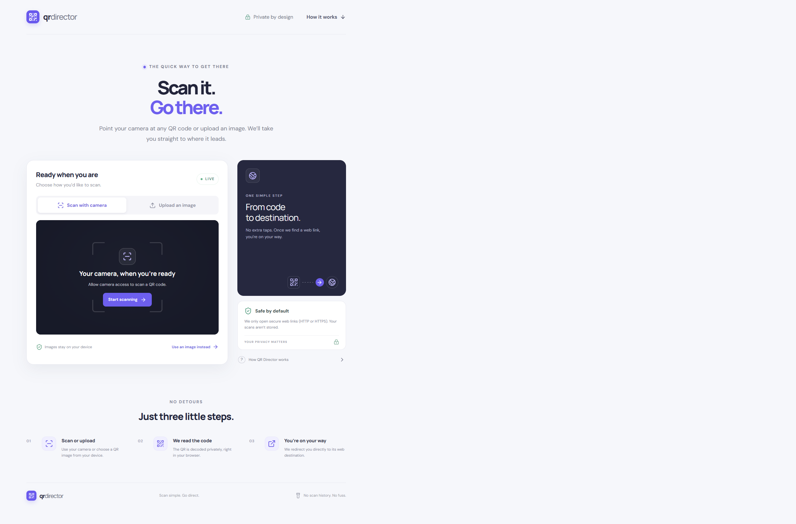
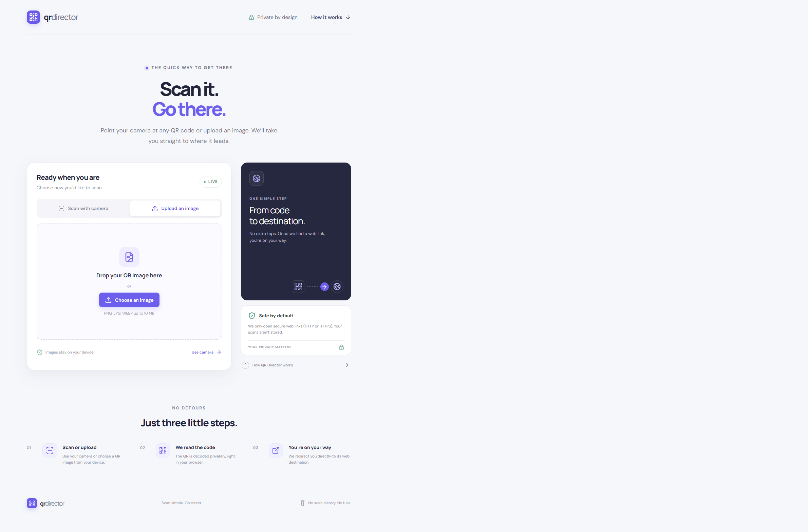

# QR Director

**Scan it. Go there.** QR Director reads a QR code from your camera or an image and takes you directly to its web destination.

<p align="center">
  
  
</p>

## What it does

- **Scan with your camera** — start the camera when you’re ready and center a QR code in the frame.
- **Upload a QR image** — choose or drop an image to decode it in your browser.
- **Go straight to the link** — valid HTTP and HTTPS destinations, including YouTube links, open automatically.
- **Keep scans private** — QR images are decoded on your device and aren’t stored.
- **Use it on any screen** — responsive layout for desktop and mobile.

> Only open QR codes from sources you trust. QR Director opens web links found in codes; it doesn’t verify the destination’s content.

## Built with

React · TypeScript · Vite · Tailwind CSS · ZXing · jsQR

## Get started

Requires Node.js 20 or newer.

```bash
npm install
npm run dev
```

Open the local URL printed by Vite. To create and preview a production build:

```bash
npm run build
npm run preview
```

## Camera permissions

Camera scanning requires your permission and a secure browser context: use `localhost` while developing, or HTTPS when deployed. Image upload works without camera access.
